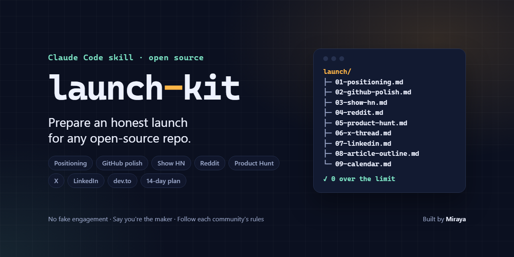

# launch-kit

**Prepare an honest launch for any open-source repo.**

launch-kit is a [Claude Code](https://code.claude.com) skill that reads your repository and writes a launch pack to `launch/`: positioning, GitHub polish with concrete README edits, ready-to-edit drafts for Show HN, Reddit, Product Hunt, X, LinkedIn and dev.to, and a 14-day launch calendar. Everything stays on your machine as markdown. You review it, rewrite it in your own words and post it yourself.

[](https://github.com/miraya-dev/launch-kit/actions/workflows/test.yml)
[](LICENSE)
[](#install)



## Quick start

In Claude Code:

```text
/plugin marketplace add miraya-dev/launch-kit
/plugin install launch-kit@launch-kit
```

Then open the repository you want to launch and ask:

```text
Prepare a launch pack for this repo.
```

or call the skill directly: `/launch-kit:launch-kit`. The pack appears in `launch/`.

## What you get

| File | What's inside |
| --- | --- |
| `00-facts.md` | Facts collected by a script: license, languages, tests, CI, demo media, community files, README outline |
| `01-positioning.md` | One-liner, who it's for, 3 key benefits with proof from the repo, an honest comparison with alternatives |
| `02-github-polish.md` | Repo description, 5 to 10 topics, a social preview image brief, a README checklist with ready-to-paste edits, LICENSE / CONTRIBUTING / good-first-issues check |
| `03-show-hn.md` | Title options and notes for your Show HN text, plus likely questions with factual answers |
| `04-reddit.md` | Suggested subreddits with the rule to check in each, and one tailored post per subreddit |
| `05-product-hunt.md` | Tagline, description, maker's first comment, thumbnail and gallery brief |
| `06-x-thread.md` | An X thread, every post counted the way X counts |
| `07-linkedin.md` | A LinkedIn post with an opening that fits before "…see more" |
| `08-article-outline.md` | A dev.to / Hashnode article outline with front matter |
| `09-calendar.md` | A 14-day launch calendar and a post-launch follow-up checklist |
| `README.md` | The index: top 3 fixes before launch and the placeholders left to fill |

**See a real pack:** [`examples/launch-kit/`](examples/launch-kit/) is the pack launch-kit wrote for its own launch.

## Why

Building the project is one job; launching it is another. Most makers either skip the launch or paste the same post everywhere, and some communities remove it for breaking their rules. launch-kit does the preparation from what is actually in your repo: it finds the gaps visitors will notice first, writes drafts tailored to each channel, and keeps you within each community's rules.

## How it works

1. `scripts/repo-facts.mjs` collects facts deterministically (no network, no dependencies): name, languages, license, tests, CI, demo media, community files, release tags.
2. Claude reads the README, manifests, main source files and docs, and looks for honest alternatives.
3. For each file of the pack it reads one reference (the channel's rules and best practices) and fills in a template.
4. `scripts/check-limits.mjs` checks every length-limited field: the Product Hunt tagline (60), Hacker News titles (80), X posts (280, with links counted as 23 and emoji as 2), the LinkedIn opening, GitHub topics.

The skill uses progressive disclosure: a short [`SKILL.md`](skills/launch-kit/SKILL.md), one [reference](skills/launch-kit/references/) per channel loaded only when needed, and [templates](skills/launch-kit/templates/) for every file of the pack.

## Install

### As a Claude Code plugin (recommended)

```text
/plugin marketplace add miraya-dev/launch-kit
/plugin install launch-kit@launch-kit
```

From a terminal: `claude plugin marketplace add miraya-dev/launch-kit` then `claude plugin install launch-kit@launch-kit`. Update later with `claude plugin update launch-kit@launch-kit`.

### Manual install

Copy only the skill folder into your personal skills folder:

```bash
git clone https://github.com/miraya-dev/launch-kit
mkdir -p ~/.claude/skills
cp -r launch-kit/skills/launch-kit ~/.claude/skills/
```

On Windows (PowerShell):

```powershell
git clone https://github.com/miraya-dev/launch-kit
New-Item -ItemType Directory -Force "$HOME\.claude\skills" | Out-Null
Copy-Item -Recurse launch-kit\skills\launch-kit "$HOME\.claude\skills\"
```

Installed this way the skill is called `/launch-kit`. For one project only, copy it to `.claude/skills/launch-kit/` in that project instead.

**Requirements:** Claude Code. Node.js 18 or newer for the two helper scripts; without Node, Claude collects the facts by hand.

## Usage

Ask in plain words, or pass arguments to the skill:

```text
Prepare a launch pack for this repo.
```

```text
/launch-kit:launch-kit ../my-project 2026-11-17
```

```text
Prepare the launch of this repo. I'm Sam (@sam on X). Launch day is Tuesday 17 November, I'm in Berlin. Skip Product Hunt and LinkedIn.
```

```text
Only do the GitHub polish and the Show HN notes.
```

```text
Here are two posts I wrote before. Match my voice in the drafts: …
```

The skill only writes inside `launch/`. When you're ready, ask: "Apply the README edits from `launch/02-github-polish.md`."

The scripts also work on their own:

```bash
node skills/launch-kit/scripts/repo-facts.mjs path/to/repo --format md --out path/to/repo/launch/00-facts.md
node skills/launch-kit/scripts/check-limits.mjs path/to/repo/launch
```

## Ethics

These rules are written into [`SKILL.md`](skills/launch-kit/SKILL.md) as hard rules. The skill declines requests that break them and offers the honest alternative.

- **No fake engagement:** no bought stars, votes or followers, no bots, no second accounts, no AI-written comments posing as users.
- **No star-for-star, vote rings or upvote groups.** Asking people to try it and give feedback is fine; asking them to vote is not.
- **No astroturfing:** no posing as a happy user, no seeded questions, no undisclosed paid posts.
- **Say you're the maker** in every post.
- **Follow each community's rules.** Every channel file starts with a link to its rules; if they say no, skip that channel.
- **Only true claims:** nothing invented, and no running down alternatives.
- **Drafts are drafts.** Hacker News asks for no generated text in posts or comments, so for HN the pack gives notes and facts, and you write the words.

The skill never posts, votes, comments or signs up anywhere.

## Limitations

- **You still do the launch.** The pack saves hours of preparation, but you rewrite, post, and stay to answer comments.
- **Rules change.** The references were checked in October 2026. Always read each community's current rules; subreddit suggestions are starting points, and the skill can't see current sidebars.
- **Comparisons can be out of date.** Claude uses what it knows, plus web search when available. Check them before posting.
- **Facts come from files only.** `repo-facts.mjs` doesn't know your stars, traffic or GitHub releases (only local tags). It understands common `.gitignore` patterns, but not negations.
- **No images.** It writes briefs for the social preview and Product Hunt gallery; you or a designer make them.
- **English by default.** Ask for another language if your community writes in one.

## Contributing

Issues and pull requests are welcome. See [CONTRIBUTING.md](CONTRIBUTING.md). Run the tests with `npm test` (Node.js 18+, no dependencies).

## License

[MIT](LICENSE) © 2026 Moncef El hirech (Miraya)

---

Built by [Miraya](https://miraya-web-el-mo-dev1.vercel.app), a software studio by Moncef El hirech.
